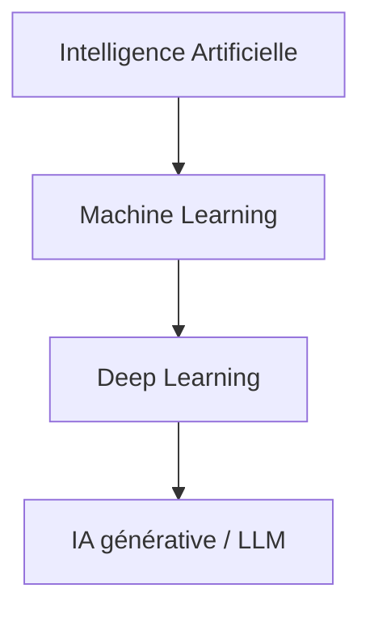

# Module A1 — Fondamentaux de l'IA

## Contenu

### 1. Qu'est-ce que l'intelligence artificielle ?

L'IA regroupe l'ensemble des techniques permettant à une machine de réaliser des tâches qui nécessitaient jusque-là une intelligence humaine (reconnaissance, prédiction, génération, décision). Trois grandes familles à distinguer :

- **Machine Learning (ML)** : le système apprend des motifs à partir de données, sans être programmé explicitement pour chaque règle. Exemple : prédire une rupture de stock à partir de l'historique des ventes.
- **Deep Learning (apprentissage profond)** : sous-catégorie du ML basée sur des réseaux de neurones à plusieurs couches, capable de traiter des données complexes (images, texte, son).
- **IA générative** : sous-catégorie du deep learning capable de produire du contenu nouveau (texte, image, code) plutôt que seulement classer ou prédire.

### 2. Les grands modèles de langage (LLM)

Un LLM (Large Language Model, ex : GPT, Claude, Gemini) est un modèle entraîné sur d'immenses volumes de texte pour prédire la suite probable d'une séquence de mots. Points clés pour un consultant :

- Un LLM ne "sait" rien au sens humain — il génère des réponses statistiquement plausibles à partir de ses données d'entraînement.
- Il possède une date de coupure des connaissances (knowledge cutoff) : au-delà, il doit s'appuyer sur des outils externes (recherche web, bases documentaires) pour rester à jour.
- Il peut produire des affirmations fausses avec assurance (hallucinations) — un point critique à expliquer à un client, en particulier dans un secteur réglementé comme la pharmacie.

### 3. Infrastructure et cloud computing

Les modèles d'IA nécessitent une puissance de calcul importante, généralement hébergée sur des serveurs cloud (AWS, Google Cloud, Azure, OVHcloud pour des besoins de souveraineté). Pour un consultant, comprendre les bases suffit :
- Différence entre IA "as a service" (API, ex : utiliser l'API Claude) et IA hébergée localement (on-premise, souvent exigée par des contraintes de confidentialité type HDS).
- Notion de coût à l'usage (facturation au volume de données traitées) vs coût d'infrastructure fixe.

### 4. Qualité et nature des données

Un projet d'IA n'est jamais meilleur que les données qui l'alimentent. Trois critères à évaluer systématiquement chez un client :
- **Disponibilité** : les données existent-elles déjà, sous quel format ?
- **Qualité** : sont-elles complètes, cohérentes, à jour ?
- **Sensibilité** : données de santé, données personnelles → cadre juridique renforcé (voir module A5).

### 5. Limites et biais

- **Biais** : un modèle reproduit les biais présents dans ses données d'entraînement (ex : sous-représentation de certains profils patients).
- **Boîte noire** : certains modèles sont difficiles à expliquer dans leur raisonnement interne — un enjeu pour la confiance et la conformité réglementaire.
- **Validation nécessaire** : toute sortie d'un modèle d'IA en santé doit être validée par un professionnel, l'IA reste une aide à la décision et non une décision autonome.

---

## Schéma — Hiérarchie des concepts

---

## Checklist de compétences

- [ ] Je sais expliquer la différence entre ML, deep learning et IA générative à un non-technicien
- [ ] Je sais expliquer ce qu'est un LLM et pourquoi il peut halluciner
- [ ] Je sais distinguer une solution IA "as a service" d'une solution hébergée localement
- [ ] Je sais énoncer les 3 critères de qualité des données à vérifier chez un client
- [ ] Je sais expliquer pourquoi un biais algorithmique est un risque, avec un exemple concret

## Quiz (5 questions)

1. Le deep learning est une sous-catégorie de :
   a) L'IA générative b) Le Machine Learning ✔ c) Le cloud computing

2. Une "hallucination" en IA désigne :
   a) Un bug d'affichage b) Une affirmation fausse produite avec assurance ✔ c) Une panne de serveur

3. HDS est une obligation qui concerne principalement :
   a) Les données de santé ✔ b) Les données financières c) Les données marketing

4. Un LLM "sait" une information au sens humain du terme :
   a) Vrai b) Faux ✔

5. Le principal risque d'un biais algorithmique en santé est :
   a) Un coût plus élevé b) Une décision inéquitable ou erronée selon les profils patients ✔ c) Une lenteur du système

## Estimation de temps d'apprentissage
**~30-35 minutes** (lecture active + quiz + checklist)
