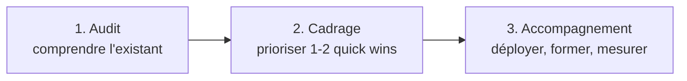

# Module A2 — Posture de conseil

## Contenu

### 1. Ce qui distingue un consultant IA d'un data scientist

Le data scientist construit des modèles prédictifs et analyse des données complexes. Le consultant IA adopte une posture plus globale : il évalue les opportunités stratégiques, définit des feuilles de route et accompagne les organisations dans leur transformation (source : FormaVie, fiche métier consultant IA, mai 2026).

Pour toi, cela signifie : ta valeur ne vient pas de ta capacité à coder un modèle, mais de ta capacité à comprendre un métier (la pharmacie) et à identifier où l'IA apporte un gain réel.

### 2. Les missions type d'un consultant IA

D'après les référentiels métier actuels (source : weblibellule, oct. 2025), les activités les plus représentatives sont :

- Audit des processus internes pour identifier irritants et surcoûts
- Analyse de la qualité des données et de leur accessibilité pour tout projet IA
- Diagnostic du niveau de maturité digitale de l'entreprise
- Estimation du ROI attendu des solutions déployées

En clair, avant de proposer un outil, tu dois d'abord comprendre : où sont les pertes de temps/argent, quelles données existent déjà, et l'équipe est-elle prête à changer ses habitudes.

### 3. Éviter le "solutionnisme aveugle"

Le consultant IA évite l'écueil du "solutionnisme aveugle", qui consiste à vouloir déployer une technologie sans comprendre son utilité réelle (source : weblibellule, oct. 2025).

C'est le piège n°1 pour un débutant : proposer un chatbot IA parce que "c'est à la mode", sans avoir vérifié qu'il répond à un besoin réel du pharmacien titulaire. Une bonne pratique : toujours partir d'un problème métier concret (ex : ruptures de stock, temps perdu en tâches administratives) avant de parler de solution technique.

### 4. Construire une feuille de route

Une mission de conseil suit généralement 3 phases :
1. **Audit** : comprendre l'existant (processus, données, logiciels déjà utilisés — ex : LGO en officine)
2. **Cadrage** : prioriser 1-2 cas d'usage à fort impact et faible complexité pour démarrer (quick wins)
3. **Accompagnement** : déployer, former les équipes, mesurer les résultats

### 5. Où et comment exercer

Le consultant IA peut exercer en cabinet de conseil, en ESN, ou en indépendant. Certains consultants se spécialisent dans un secteur (santé, finance, industrie), d'autres dans une thématique transversale (éthique IA, gouvernance des données, automatisation des processus) (source : weblibellule, oct. 2025).

Pour toi, la voie la plus cohérente avec ton profil est l'indépendant spécialisé secteur (pharmacie/santé), en t'appuyant sur ton expérience de pharmacien-chemiste et tes projets déjà en cours (CFPpro.nc, anamnèse naturopathique) comme preuves de compétence.

---

## Schéma — Feuille de route d'une mission de conseil

---

## Checklist de compétences

- [ ] Je sais expliquer la différence de posture entre consultant IA et data scientist
- [ ] Je sais mener un audit simple : identifier 3 irritants métier chez un pharmacien titulaire
- [ ] Je sais reconnaître un cas de "solutionnisme aveugle" et le reformuler en besoin métier
- [ ] Je sais structurer une feuille de route en 3 phases (audit / cadrage / accompagnement)
- [ ] Je sais argumenter pourquoi la spécialisation sectorielle est un avantage concurrentiel

## Quiz (5 questions)

1. La valeur principale d'un consultant IA (par opposition à un data scientist) est :
   a) Coder des modèles b) Comprendre le métier et cadrer les opportunités stratégiques ✔ c) Gérer des serveurs

2. Le "solutionnisme aveugle" désigne :
   a) Une panne technique b) Déployer une technologie sans comprendre son utilité réelle ✔ c) Un manque de budget

3. La première phase d'une mission de conseil IA est généralement :
   a) L'audit ✔ b) Le déploiement c) La facturation

4. Un "quick win" en conseil IA désigne :
   a) Un contrat long terme b) Un cas d'usage à fort impact et faible complexité pour démarrer ✔ c) Une réduction de prix

5. Se spécialiser sur un secteur (ex : pharmacie) plutôt que rester généraliste est présenté comme :
   a) Un désavantage b) Un atout de différenciation valorisé ✔ c) Sans effet sur le marché

---

*Sources : FormaVie (fiche métier consultant IA, mai 2026), weblibellule (consultant IA en 2026 : rôles, compétences et opportunités, oct. 2025)*

## Estimation de temps d'apprentissage
**~30-35 minutes** (lecture active + quiz + checklist)
