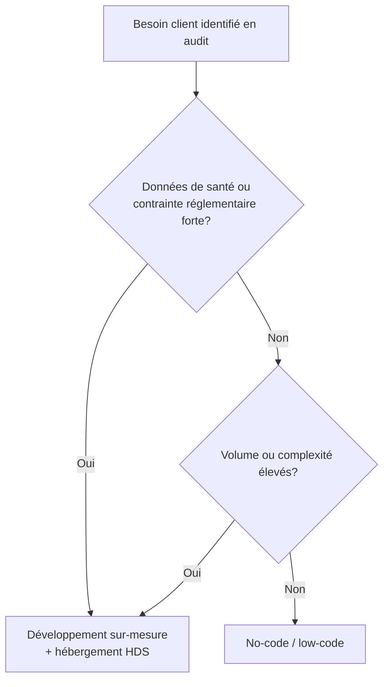

# Module A3 — Data & infrastructure, choix d'outils

## Contenu

### 1. Cartographier les données avant de choisir un outil

Avant de recommander un outil, un consultant IA doit cartographier ce qui existe déjà chez le client :
- Où sont les données (LGO, tableur Excel, papier) ?
- Sont-elles structurées (base de données) ou non structurées (notes libres, PDF) ?
- Qui y a accès, et sous quelle autorisation ?

Cette cartographie précède toujours le choix technique — proposer un outil avant d'avoir fait cet état des lieux est une erreur fréquente chez les débutants.

### 2. No-code vs développement sur-mesure

Deux grandes familles d'approches pour répondre à un besoin client :

| Critère | No-code / low-code | Développement sur-mesure |
|---|---|---|
| Coût initial | Faible | Élevé |
| Délai de mise en œuvre | Jours à semaines | Semaines à mois |
| Flexibilité | Limitée aux briques existantes | Totale |
| Pertinent pour | Automatisations simples, prototypes, petites structures | Besoins spécifiques, fort volume, contraintes réglementaires strictes (ex : HDS) |

**Repère pratique** : pour un premier client officine, une automatisation no-code (ex : synthèse automatique de mails fournisseurs) est souvent plus réaliste qu'un développement sur-mesure — sauf si la donnée manipulée est une donnée de santé, auquel cas l'hébergement HDS devient prioritaire sur la simplicité de mise en œuvre.

### 3. Cloud computing : les bases utiles à un consultant

- **IaaS/PaaS/SaaS** : trois niveaux de service cloud, du plus technique (infrastructure brute) au plus clé-en-main (logiciel prêt à l'emploi).
- **Souveraineté des données** : pour un client en France, privilégier un hébergeur certifié HDS et, si le client y est sensible, un acteur européen (OVHcloud) plutôt qu'un hyperscaler américain, selon ses exigences de conformité.
- **Coût à l'usage vs coût fixe** : un modèle "pay-as-you-go" (API IA facturée au volume) convient à un prototype ; un abonnement fixe convient mieux à un usage prévisible et récurrent.

### 4. Critères de sélection d'un outil IA pour un client

1. Répond-il à un besoin métier identifié en audit (pas une mode) ?
2. S'intègre-t-il à l'existant (LGO, outils déjà utilisés) ?
3. Est-il conforme aux obligations du secteur (HDS si données de santé) ?
4. Le coût est-il proportionné au gain attendu (voir module A4) ?
5. L'équipe cliente est-elle capable de l'adopter sans formation excessive ?

---

## Schéma — Choisir no-code ou développement sur-mesure

---

## Checklist de compétences

- [ ] Je sais cartographier les données existantes d'un client avant de proposer un outil
- [ ] Je sais expliquer la différence no-code / développement sur-mesure et quand privilégier l'un ou l'autre
- [ ] Je sais expliquer IaaS/PaaS/SaaS simplement
- [ ] Je sais argumenter un choix d'hébergeur selon les exigences de conformité du client
- [ ] Je sais appliquer une grille de critères pour sélectionner un outil IA adapté

## Quiz (5 questions)

1. La première étape avant de choisir un outil IA pour un client est :
   a) Comparer les prix b) Cartographier les données existantes ✔ c) Choisir le no-code par défaut

2. Le no-code est généralement préférable pour :
   a) Manipuler des données de santé sensibles b) Des automatisations simples et rapides à mettre en œuvre ✔ c) Les très gros volumes réglementés

3. SaaS signifie :
   a) Software as a Service ✔ b) System as a Solution c) Server and Application Software

4. Un modèle de facturation "pay-as-you-go" convient particulièrement à :
   a) Un usage fixe et prévisible b) Un prototype ou un usage variable ✔ c) Une obligation légale

5. Le critère le plus important dans le choix d'un outil IA pour un client est :
   a) La nouveauté technologique b) La réponse à un besoin métier réel identifié en audit ✔ c) Le nombre de fonctionnalités

## Estimation de temps d'apprentissage
**~30-40 minutes**
