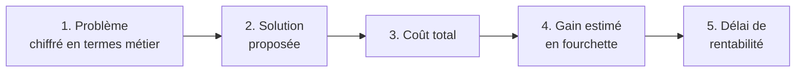

# Module A4 — ROI & business case

## Contenu

### 1. Pourquoi le ROI est central en conseil IA

Un décideur (ex : pharmacien titulaire) n'investit pas dans une technologie parce qu'elle est innovante, mais parce qu'elle résout un problème à un coût justifié. Savoir chiffrer un retour sur investissement (ROI) est ce qui distingue une proposition crédible d'un argumentaire marketing.

### 2. Méthode de calcul simple du ROI

Formule de base :

```
ROI (%) = (Gain généré - Coût de la solution) / Coût de la solution × 100
```

Pour construire ce calcul, il faut identifier deux types de gains :
- **Gains tangibles** : temps gagné (converti en coût salarial), pertes évitées (ex : produits périmés), stock optimisé (trésorerie libérée)
- **Gains intangibles** : satisfaction client, image de modernité, réduction du stress de l'équipe — plus difficiles à chiffrer, à mentionner mais pas à sur-vendre

### 3. Construire un business case simple

Un business case convaincant pour un client contient généralement :
1. **Le problème** : décrit en termes métier, pas techniques ("3h/semaine perdues en gestion de commandes", pas "absence d'algorithme prédictif")
2. **La solution proposée** : ce qu'elle fait concrètement, sans jargon
3. **Le coût total** : licence/abonnement + temps de mise en œuvre + formation
4. **Le gain attendu** : chiffré, avec une fourchette prudente plutôt qu'un chiffre optimiste unique
5. **Le délai de rentabilité** : à partir de quand le gain dépasse le coût

### 4. Présenter à un décideur non technique

- Éviter le jargon IA (LLM, prompt, API) — traduire en bénéfices concrets
- Toujours donner une fourchette (ex : "gain estimé entre X et Y") plutôt qu'un chiffre unique qui paraît arbitraire
- Anticiper les objections : "et si l'outil se trompe ?", "combien de temps pour être opérationnel ?", "qui forme l'équipe ?"
- Proposer un test à petite échelle (pilote) avant un déploiement complet — réduit le risque perçu par le client

### 5. Prudence sur les chiffres annoncés par les éditeurs

Attention : les chiffres de gains "types" communiqués par des éditeurs commerciaux (ex : "-30% de ruptures", "-25% de périmés") sont des moyennes marketing, pas des garanties. En tant que consultant, ta valeur ajoutée est de vérifier ces chiffres sur le terrain avec le client (données réelles avant/après) plutôt que de les reprendre tels quels dans ta proposition.

---

## Schéma — Structure d'un business case



---

## Checklist de compétences

- [ ] Je sais calculer un ROI simple à partir de gains et coûts identifiés
- [ ] Je sais distinguer gains tangibles et intangibles dans un business case
- [ ] Je sais structurer un business case en 5 points pour un décideur non technique
- [ ] Je sais anticiper au moins 3 objections courantes d'un titulaire d'officine
- [ ] Je sais expliquer pourquoi il faut vérifier les chiffres d'un éditeur plutôt que les reprendre tels quels

## Quiz (5 questions)

1. La formule du ROI est :
   a) Coût / Gain b) (Gain - Coût) / Coût × 100 ✔ c) Gain × Coût

2. Un exemple de gain tangible est :
   a) L'image de modernité b) Le temps administratif gagné, converti en coût salarial ✔ c) La satisfaction client

3. Face à un chiffre de gain annoncé par un éditeur commercial, un bon réflexe de consultant est :
   a) Le reprendre tel quel dans sa proposition b) Le vérifier sur le terrain avec les données réelles du client ✔ c) L'ignorer systématiquement

4. Dans un business case, il vaut mieux présenter :
   a) Un chiffre unique optimiste b) Une fourchette prudente de gain estimé ✔ c) Aucun chiffre pour rester prudent

5. Proposer un test à petite échelle avant un déploiement complet permet de :
   a) Réduire le risque perçu par le client ✔ b) Éviter de faire un business case c) Augmenter le prix final

## Estimation de temps d'apprentissage
**~30-40 minutes**
