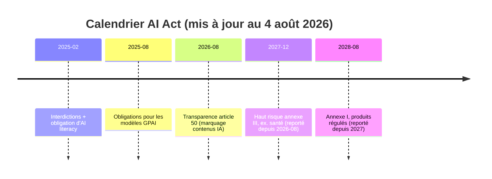
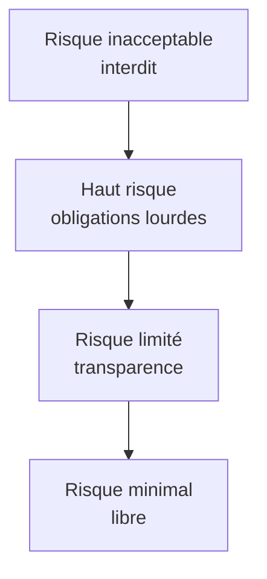

# Module A5 — Réglementaire transversal : AI Act, RGPD, gouvernance, éthique

## Contenu

### 1. L'AI Act : ce qu'il faut savoir en tant que consultant

Le Règlement européen sur l'IA (UE 2024/1689), dit AI Act, est entré en vigueur le 1er août 2024. Il classe les systèmes d'IA selon 4 niveaux de risque : inacceptable (interdit), haut risque (obligations lourdes), risque limité (transparence), risque minimal (libre).

**Calendrier à jour au 4 août 2026** (important : ce calendrier a été récemment modifié, sois vigilant sur ce point avec tes clients) :
- **2 février 2025** : interdictions et obligation d'"AI literacy" (maîtrise minimale de l'IA par le personnel) déjà en vigueur
- **2 août 2025** : obligations pour les modèles d'IA à usage général (GPAI) déjà en vigueur
- **2 août 2026** (aujourd'hui même, quasiment) : obligations de transparence de l'article 50 — informer les utilisateurs qu'ils interagissent avec une IA, marquage des contenus générés par IA
- **2 décembre 2027** : la majorité des obligations pour les systèmes à haut risque (annexe III, incluant la santé) — cette date a été **reportée** depuis le 2 août 2026 initialement prévu, suite à l'adoption d'un règlement dit "Digital Omnibus" (règlement UE 2026/1744, en vigueur depuis le 27 juillet 2026)
- **2 août 2028** : application aux systèmes intégrés dans certains produits régulés (annexe I) — également reportée depuis 2027

**Point clé pour toi** : ce report ne signifie pas que la conformité peut attendre — il donne un délai supplémentaire aux organisations pour s'organiser, pas une dispense. Un système d'IA utilisé en santé (annexe III) reste un sujet à haut risque à anticiper, même si l'échéance légale est repoussée.

### 2. Articulation AI Act / RGPD

Les deux réglementations sont complémentaires et peuvent s'appliquer simultanément : l'AI Act encadre les systèmes d'IA en tant que tels, le RGPD encadre spécifiquement les données personnelles qu'ils traitent. Un système d'IA en pharmacie traitant des données patient est donc soumis aux deux cadres en parallèle.

### 3. Gouvernance de l'IA en pratique (méthode à appliquer chez un client)

1. **Cartographier** les usages d'IA existants ou envisagés chez le client
2. **Qualifier** le niveau de risque de chaque usage (minimal/limité/haut risque/inacceptable)
3. **Formaliser une gouvernance interne** : qui valide l'usage d'un outil IA, qui supervise, qui documente
4. **Former les équipes** à l'usage responsable (obligation d'"AI literacy" déjà en vigueur depuis février 2025)

### 4. Éthique de l'IA en santé : principes clés

- **Supervision humaine obligatoire** : une IA ne doit jamais être la seule décisionnaire dans un acte de soin ou de conseil pharmaceutique
- **Explicabilité** : privilégier des outils dont les recommandations peuvent être justifiées, en particulier en contexte réglementé
- **Non-discrimination** : vérifier qu'un outil ne désavantage pas certains profils de patients (biais, voir module A1)
- **Transparence envers le patient** : informer si un contenu ou une interaction implique de l'IA, conformément à l'article 50 de l'AI Act

### 5. Sanctions

Les manquements à l'AI Act peuvent être sanctionnés jusqu'à 35 millions d'euros ou 7% du chiffre d'affaires mondial selon la gravité — un argument utile pour sensibiliser un client à la nécessité d'une démarche de conformité, même progressive.

---

## Schéma — Calendrier AI Act (à jour août 2026)

## Schéma — Les 4 niveaux de risque

---

## Checklist de compétences

- [ ] Je sais expliquer les 4 niveaux de risque de l'AI Act
- [ ] Je sais donner le calendrier à jour de l'AI Act (et expliquer pourquoi il a changé récemment)
- [ ] Je sais expliquer comment AI Act et RGPD s'articulent
- [ ] Je sais dérouler une méthode de gouvernance IA en 4 étapes pour un client
- [ ] Je sais énoncer les 4 principes éthiques clés pour l'IA en santé

## Quiz (5 questions)

1. L'AI Act est entré en vigueur le :
   a) 1er août 2024 ✔ b) 2 août 2026 c) 13 juin 2024

2. Le "Digital Omnibus" adopté en 2026 a eu pour effet de :
   a) Avancer les obligations haut risque b) Reporter les obligations haut risque (annexe III) au 2 décembre 2027 ✔ c) Supprimer l'AI Act

3. Les obligations de transparence de l'article 50 (informer qu'on interagit avec une IA) s'appliquent depuis :
   a) 2 février 2025 b) 2 août 2026 ✔ c) 2 décembre 2027

4. L'AI Act et le RGPD :
   a) S'excluent mutuellement b) Peuvent s'appliquer simultanément à un même système ✔ c) Ne concernent jamais le même sujet

5. Le report du calendrier "haut risque" signifie que :
   a) La conformité peut être totalement ignorée jusqu'en 2027 b) Un délai d'organisation est accordé, mais l'anticipation reste recommandée ✔ c) Le règlement est abandonné

---

*Sources (calendrier vérifié au 4 août 2026, sujet évolutif à recontrôler périodiquement) : Conseil de l'Union européenne (accord définitif Digital Omnibus, 29 juin 2026), Blog du Modérateur (2 août 2026), Studeria.fr, mdp-data.com, Leto.legal, Adevweb.com.*

## Estimation de temps d'apprentissage
**~40-50 minutes** (contenu réglementaire dense, calendrier à recontrôler avant toute présentation client car sujet évolutif).
