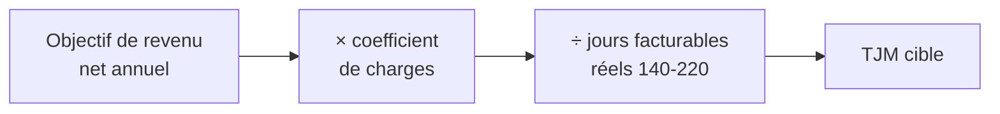

# Module A6 — Développer son activité de consultant IA

## Contenu

### 1. Statut juridique : les grandes options

Pour démarrer une activité de conseil en France, plusieurs statuts existent : micro-entreprise (auto-entrepreneur), EURL/SASU (société unipersonnelle), ou portage salarial. Chacun a des implications différentes en termes de charges sociales, de plafond de chiffre d'affaires, et de régime fiscal.

**Important — je ne suis pas expert-comptable** : les seuils, taux de cotisation et plafonds évoluent régulièrement. Vérifie les chiffres exacts (plafond micro-entreprise, franchise en base de TVA, taux URSSAF) auprès d'un expert-comptable ou sur le site officiel de l'URSSAF avant de choisir, plutôt que de te fier à un chiffre que je pourrais te donner de mémoire et qui serait daté.

### 2. Fixer son TJM (Tarif Journalier Moyen)

Le TJM est l'unité de référence en B2B pour un consultant indépendant en France. Quelques repères de marché en 2026, à titre indicatif (les fourchettes varient significativement selon les sources et évoluent) :

- Un consultant IA débutant ou non-technique facture généralement entre 300 et 500 €/jour, pour des missions d'acculturation ou d'assistance au déploiement
- Un profil confirmé, avec 2-3 cas clients documentés et chiffrés, peut atteindre 600 à 900 €/jour
- Les compétences les plus valorisées sur le marché IA en 2026 : maîtrise des API (Anthropic, OpenAI, Mistral), orchestration d'agents, connaissance du RGPD et de l'AI Act, et surtout un portfolio de projets IA réellement en production (pas seulement des prototypes)

**Méthode de calcul de ton TJM cible** :
```
TJM = (Objectif de revenu net annuel × coefficient de charges) ÷ Nombre de jours facturables réels
```
Le nombre de jours réellement facturables se situe souvent entre 140 et 220 jours/an selon les profils — ne pas calculer sur 220 jours d'emblée si tu démarres, car la prospection et l'administratif prennent du temps non facturable.

### 3. Construire son offre initiale

Plutôt que de te présenter comme "consultant IA généraliste", ton positionnement le plus fort est la spécialisation sectorielle (pharmacie/officine) combinée à ton statut de pharmacien — c'est un argument de crédibilité immédiat face à un titulaire d'officine, bien plus qu'un certificat générique en IA.

Une offre de démarrage réaliste :
1. **Diagnostic/audit** (mission courte, tarif d'appel) : identifier 2-3 cas d'usage prioritaires chez un client
2. **Accompagnement au déploiement** d'un cas d'usage précis (mission plus longue)
3. **Formation de l'équipe** à l'usage responsable de l'outil déployé

### 4. Prospection : par où commencer

- **Réseau existant** : groupements de pharmacies, syndicats professionnels (ex : USPO), contacts de ta formation initiale de pharmacien
- **Preuve par l'exemple** : documenter un premier cas d'usage (même à titre gratuit ou à tarif réduit pour un client pilote) pour avoir un cas concret et chiffré à présenter ensuite
- **Présence en ligne** : profil sur une plateforme de mise en relation freelance (type Malt), ou simplement un site vitrine présentant ta double expertise pharmacien + IA

### 5. Erreurs fréquentes à éviter en démarrant

- Sous-facturer par manque de confiance, ce qui dévalorise ton expertise sectorielle
- Se positionner comme généraliste IA plutôt que spécialiste pharmacie — la concurrence généraliste est bien plus rude
- Vendre une "techno" plutôt qu'un résultat métier chiffré (voir module A4)
- Oublier d'intégrer dans son TJM les temps non facturables (administratif, prospection, formation continue)

---

## Schéma — Calcul du TJM cible



---

## Checklist de compétences

- [ ] Je connais les grandes options de statut juridique et sais qu'il faut vérifier les chiffres à jour avec un professionnel
- [ ] Je sais calculer un TJM cible à partir d'un objectif de revenu et d'un nombre de jours facturables réalistes
- [ ] Je sais construire une offre de démarrage en 3 étapes (audit, déploiement, formation)
- [ ] Je sais identifier au moins 3 canaux de prospection pertinents pour mon profil
- [ ] Je sais énoncer 3 erreurs fréquentes à éviter en démarrant une activité de conseil

## Quiz (5 questions)

1. Le TJM désigne :
   a) Le Temps de Justification Mensuel b) Le Tarif Journalier Moyen ✔ c) Le Taux de Justesse Métier

2. D'après les repères de marché 2026, un consultant IA débutant facture généralement :
   a) 50-100 €/jour b) 300-500 €/jour ✔ c) 2000-3000 €/jour

3. Le nombre de jours réellement facturables par an pour un consultant indépendant se situe souvent :
   a) Autour de 300-350 jours b) Entre 140 et 220 jours ✔ c) Autour de 50 jours

4. Ton positionnement le plus fort face à une officine est :
   a) Consultant IA généraliste b) Spécialiste pharmacie/officine, appuyé sur ton statut de pharmacien ✔ c) Expert en développement de LLM

5. Une erreur fréquente en démarrant une activité de conseil est :
   a) Documenter un cas client chiffré b) Sous-facturer par manque de confiance ✔ c) Se spécialiser sur un secteur

---

*Sources : Studeria.fr (TJM consultant IA 2026), Plateya.fr (tarifs consultant IA 2026), Kaliio.fr (tarif formateur indépendant, juill. 2026), L-Expert-Comptable.com (calcul TJM, juin 2026) — chiffres de marché à titre indicatif, à recouper avec des baromètres à jour (Malt, Free-Work) au moment où tu fixeras tes tarifs.*

## Estimation de temps d'apprentissage
**~35-45 minutes**
