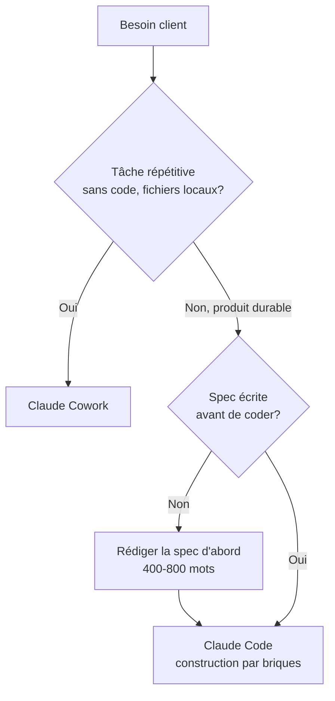

# Module A7 — Construire des solutions SaaS/automatisation avec Claude Code (optionnel)

## Contenu

*Module optionnel, complémentaire au tronc A. Objectif : savoir utiliser Claude Code comme outil de production pour livrer des solutions IA à des entreprises clientes — pas seulement pour toi-même.*

### 1. Distinguer les deux outils : Claude Code vs Claude Cowork

Ce sont deux outils complémentaires, pas concurrents :
- **Claude Code** est l'agent de développement qui écrit, teste et débogue du code de façon autonome — adapté pour construire des micro-SaaS, des outils internes ou des MVP complets.
- **Claude Cowork** donne à Claude un accès direct aux fichiers locaux et à l'ordinateur d'un utilisateur non-technique dans un environnement isolé : automatiser des tâches répétitives (traiter des factures, renommer des fichiers, générer des rapports récurrents), sans écrire de code.

**Pour toi, consultant** : Cowork est souvent le bon point d'entrée pour un client PME peu technique qui veut automatiser une tâche ponctuelle sans investir dans un outil sur-mesure. Claude Code devient pertinent quand le besoin justifie un outil propriétaire durable (dashboard, base de données, multi-utilisateurs).

### 2. La méthode qui fonctionne : la spec avant les prompts

Le facteur de succès documenté n'est pas la qualité du prompt individuel, mais l'existence d'une spécification écrite *avant* de commencer à coder. Un exemple documenté : un développeur ayant livré un SaaS de 38 632 lignes de code en 8 semaines (95% généré par l'IA) attribue son efficacité à une spec définie en amont, pas à des prompts habiles.

**Format qui fonctionne** : une spec de 400 à 800 mots que Claude Code lit dans son contexte initial — ni un cahier des charges de 40 pages, ni une idée vague en une phrase. Compter 2 à 3 heures pour la rédiger correctement. C'est exactement la méthode qu'on a appliquée pour l'app "Consultant IA" elle-même (fichier `consultant-ia-app-specs.md`) — tu as donc déjà pratiqué cette compétence.

### 3. Pourquoi sans cadre clair, ça part en vrille

Des données de 2026 (rapport Panto AI) montrent que sans revue manuelle rigoureuse : le taux de défauts post-fusion (post-merge) augmente de 7 à 15% dans les équipes qui ne relisent pas le code généré, et les gros commits générés par IA sont annulés (revert) 30% plus souvent que des commits humains de taille équivalente. Ce que tu ne spécifies pas en amont, tu le débogues en aval.

**Conséquence pour ton rôle de consultant** : ta valeur n'est pas de "prompter vite", c'est de cadrer correctement le besoin client avant de lancer la construction — exactement la posture de conseil vue en module A2.

### 4. Complexité et délais réalistes à annoncer à un client

Des repères de terrain à connaître pour ne pas sous-estimer un devis :
- Un outil simple (calculateur, générateur, petit tableau de bord sans compte utilisateur) : 20-30 minutes à quelques heures de session
- Un SaaS complet avec authentification, paiement, tableau de bord admin et gestion multi-utilisateurs : plusieurs jours de sessions itératives
- Un outil interne métier sur-mesure (ex : gestion de projets adaptée à un workflow spécifique) : documenté à ~2 semaines de développement dans un cas réel, avec un gain de 6h/semaine sur l'administration pour l'entreprise cliente

**Ne jamais promettre un SaaS complet "en 20 minutes" à un client** — c'est vrai pour un prototype front-end simple, pas pour un produit avec données persistantes et sécurisées.

### 5. Cas d'usage concret : automatisation de tâches répétitives en entreprise

Exemples déjà documentés en usage réel :
- Traitement automatisé de factures ou de documents entrants
- Génération de rapports récurrents (hebdomadaires, mensuels) à partir de données existantes
- Automatisation de la synchronisation entre outils déjà utilisés par l'entreprise (éviter la ressaisie manuelle entre applications)
- Remplacement d'un outil SaaS payant externe par un outil interne sur-mesure, quand le besoin est stable et bien identifié

**Application à ton contexte néo-calédonien** : les PME locales (artisans BTP, comme pour CFPpro.nc) ont souvent des processus encore très manuels (devis, facturation, suivi de stock) — un terrain favorable pour ce type de mission, à condition de partir d'un irritant métier réel (méthode d'audit vue en A2), pas d'une solution technique décidée à l'avance.

### 6. Modèle économique pour ce type de mission

Deux logiques possibles, à ne pas confondre :
- **Mission ponctuelle facturée au forfait ou en TJM** (voir module A6) : tu livres un outil, le client en devient propriétaire, pas d'abonnement récurrent de ta part.
- **Modèle SaaS avec abonnement récurrent** : pertinent seulement si tu développais un produit générique réutilisable pour plusieurs clients (ex : un outil d'automatisation type pour les officines) — le modèle qui maximise l'acquisition et la fidélisation en 2026 reste généralement l'abonnement mensuel par paliers avec un niveau gratuit ("freemium") pour réduire la friction à l'entrée.

**Point de vigilance** : le modèle abonnement suppose une maintenance continue (support, mises à jour, hébergement) — ne t'engage sur ce modèle qu'après avoir validé qu'un premier client est prêt à payer pour une mission ponctuelle d'abord.

### 7. Limites à connaître et à expliquer à un client

- Claude Code ne remplace pas une revue de sécurité pour une application manipulant des données sensibles (voir modules B1/A5 sur HDS/RGPD)
- Un prototype fonctionnel n'est pas un produit prêt pour la production (tests, gestion des erreurs, sauvegardes)
- La supervision humaine reste nécessaire à chaque étape critique, en particulier avant tout déploiement chez un client

---

## Schéma — Choisir Claude Code ou Claude Cowork

---

## Checklist de compétences

- [ ] Je sais expliquer la différence d'usage entre Claude Code et Claude Cowork pour un client
- [ ] Je sais rédiger une spec de 400-800 mots avant de lancer une construction avec Claude Code
- [ ] Je sais donner un délai réaliste à un client selon la complexité de l'outil demandé
- [ ] Je sais identifier un irritant métier réel chez un client avant de proposer une automatisation
- [ ] Je sais expliquer la différence entre facturer une mission ponctuelle et lancer un modèle SaaS par abonnement
- [ ] Je sais énoncer au moins 2 limites à mentionner à un client avant tout déploiement

## Quiz (6 questions)

1. Claude Cowork est plutôt adapté pour :
   a) Construire un SaaS complet avec base de données b) Automatiser des tâches répétitives sans écrire de code, pour un utilisateur non-technique ✔ c) Remplacer un développeur senior

2. Le facteur de succès documenté pour un projet Claude Code réussi est principalement :
   a) La rapidité de frappe des prompts b) L'existence d'une spec écrite avant de commencer à coder ✔ c) Le nombre de sessions ouvertes en parallèle

3. Sans revue manuelle rigoureuse du code généré par IA, un rapport 2026 (Panto AI) indique que :
   a) Le taux de défauts post-merge diminue b) Le taux de défauts post-merge augmente de 7 à 15% ✔ c) Il n'y a aucun impact mesurable

4. Un SaaS complet avec authentification, paiement et multi-utilisateurs se construit généralement :
   a) En 20 minutes b) En plusieurs jours de sessions itératives ✔ c) En 6 mois minimum obligatoirement

5. Avant de proposer une automatisation à un client, la première étape est :
   a) Choisir l'outil technique b) Identifier un irritant métier réel (méthode d'audit) ✔ c) Fixer le prix

6. Le modèle économique "abonnement récurrent" n'est pertinent que si :
   a) Tu factures toujours à la mission b) Tu développes un produit générique réutilisable pour plusieurs clients ✔ c) Le client n'a qu'un besoin ponctuel

---

*Sources : Hubfi.fr (méthode "spec avant les prompts", mai 2026, citant un rapport Panto AI 2026), Lucas Fonseque (création d'outils SaaS avec Claude, avril 2026), Just Use AI (guide Claude Code SaaS 2026, mai-juillet 2026, cas client documenté), Volteyr (guide Claude 2026, description officielle de Claude Cowork, juin 2026), LYVIA (modèles de monétisation SaaS IA, mars 2026).*

## Estimation de temps d'apprentissage
**~45-55 minutes** (module dense, avec une dimension pratique à tester directement sur un cas réel après lecture — idéalement ton propre projet CFPpro.nc ou un premier client pilote)
