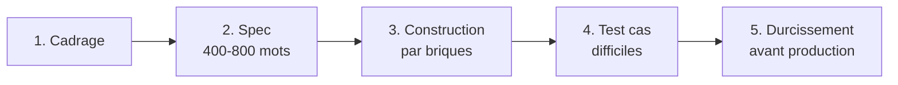
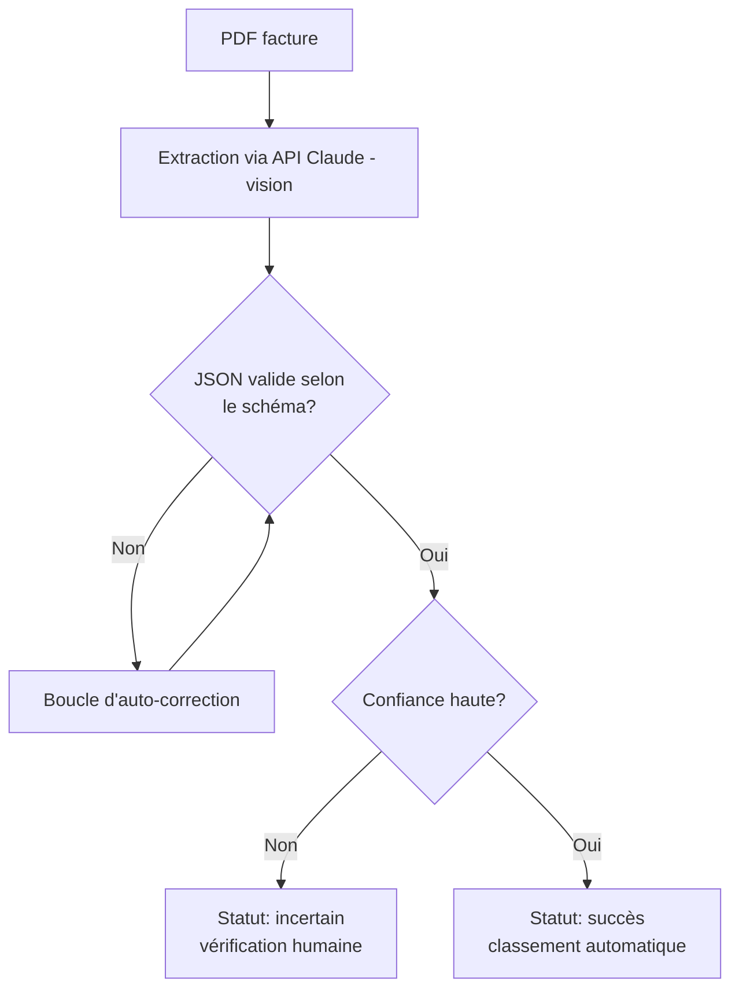

# Module A8 — Construire une automatisation de A à Z (guide pratique)

## Contenu

*Module pratique, complémentaire à A7 (qui donne la méthode et la posture). Ici : deux cas d'usage concrets, avec les prompts réels à taper dans Claude Code, étape par étape.*

### 0. Méthode générale réutilisable (à appliquer à n'importe quelle automatisation)

1. **Cadrage** : décrire le processus manuel actuel en 4-5 phrases (qui fait quoi, avec quels documents/outils, combien de temps ça prend)
2. **Spec courte** (400-800 mots, comme vu en A7) : ce que l'automatisation doit faire, ce qu'elle ne doit PAS faire, les cas limites connus
3. **Construction en Claude Code par étapes** : jamais tout d'un coup — un prompt = une brique fonctionnelle testable
4. **Test sur cas réels variés** : pas seulement l'exemple parfait, mais aussi les cas moches (PDF scanné de travers, demande de rendez-vous ambiguë)
5. **Durcissement avant production** : gestion d'erreur explicite, jamais de "traitement silencieux" d'un cas qui échoue — toujours une file d'attente manuelle en secours

**Règle d'or technique à connaître** : pour l'extraction de données (factures, documents), la bonne pratique 2026 est de faire valider la sortie du modèle par un schéma strict (JSON Schema ou équivalent), avec une boucle d'auto-correction si le format est invalide — ne jamais faire confiance à une sortie JSON brute d'un LLM sans validation.

---

## Cas pratique 1 — Tri automatique de factures fournisseurs

### Objectif du cas
Un client (ex : une officine ou un artisan BTP) reçoit des factures fournisseurs par email en PDF. Aujourd'hui, une personne les ouvre, note manuellement montant/fournisseur/date d'échéance dans un tableur, et les classe par catégorie.

### Étape 1 — Cadrage (à écrire toi-même, pas un prompt)
Note le process actuel : d'où viennent les factures (email, scan papier ?), sont-elles en PDF natif (texte sélectionnable) ou scannées (image) ? — cette distinction change tout techniquement. Un mélange des deux est fréquent en PME, prévois donc de gérer les deux cas.

### Étape 2 — Prompt de spec (Claude Code ou Claude.ai, avant de coder)
```
Aide-moi à rédiger une spec de 400-800 mots pour une automatisation de tri de factures fournisseurs.

Contexte : [décris ici le client, ex : une officine recevant ~30 factures PDF/mois par email, mélange de PDF natifs et scannés].

L'outil doit :
- Recevoir un PDF de facture (upload manuel dans une interface web pour commencer, pas d'intégration email automatique dans cette v1)
- Extraire : nom du fournisseur, numéro de facture, date d'émission, date d'échéance, montant HT, montant TVA, montant TTC
- Classer la facture dans une catégorie (ex : "fournitures", "loyer", "prestataire") à partir d'une liste de catégories que je définirai
- Stocker le résultat dans une base de données consultable
- Signaler explicitement les factures où l'extraction a échoué ou est incertaine, sans jamais les classer silencieusement

Écris cette spec en français, avec une section "hors scope v1" clairement identifiée.
```

### Étape 3 — Prompt de scaffolding (dans Claude Code)
```
Voici la spec de l'outil de tri de factures : [colle la spec générée à l'étape 2]

Initialise un projet Next.js + TypeScript + Tailwind + Supabase pour cet outil.

Crée le schéma de base de données : factures (id, fichier_url, fournisseur, numero_facture, date_emission, date_echeance, montant_ht, montant_tva, montant_ttc, categorie, statut_extraction, date_import).

statut_extraction doit pouvoir valoir : 'succes', 'incertain', 'echec'.
```

### Étape 4 — Prompt d'extraction (le cœur technique)
```
Crée une fonction d'extraction de données de facture à partir d'un PDF, en utilisant l'API Claude (modèle vision, capable de lire des PDF natifs et scannés).

Le prompt envoyé à l'API Claude doit demander une sortie strictement au format JSON, avec ce schéma exact :
{ "fournisseur": string, "numero_facture": string, "date_emission": string, "date_echeance": string, "montant_ht": number, "montant_tva": number, "montant_ttc": number, "confiance": "haute"|"moyenne"|"basse" }

Ajoute une validation du JSON reçu (schema validation). Si le JSON est invalide, renvoie une deuxième requête à l'API demandant une correction, avant d'abandonner et de marquer la facture en statut_extraction = 'echec'.

Si le champ "confiance" renvoyé est "basse", marque statut_extraction = 'incertain' plutôt que 'succes', même si le JSON est valide.
```

### Étape 5 — Prompt de classification par catégorie
```
Ajoute une étape de classification automatique de la catégorie de la facture (fournitures / loyer / prestataire / autre), à partir du nom du fournisseur et du contenu extrait.

Si aucune catégorie ne peut être déterminée avec confiance, laisse le champ catégorie vide plutôt que de deviner, et signale-le dans l'interface pour une classification manuelle.
```

### Étape 6 — Interface de vérification humaine (indispensable)
```
Crée une page listant toutes les factures avec statut_extraction = 'incertain' ou 'echec'.

Pour chaque facture, affiche le PDF original à côté des champs extraits (éditables), pour permettre une correction manuelle rapide avant validation définitive.

Cette page doit être la première chose que l'utilisateur voit après un import, pas une fonctionnalité secondaire.
```

### Étape 7 — Test
```
Aide-moi à tester cet outil avec des cas volontairement difficiles : un PDF scanné de travers, une facture avec un format inhabituel, une facture avec des montants qui ne s'additionnent pas correctement. Pour chaque cas, vérifie que l'outil signale bien l'incertitude plutôt que d'inventer une valeur.
```

**Repère de délai réaliste** (voir A7) : compter plusieurs sessions de travail réparties sur quelques jours pour une v1 fonctionnelle et testée — pas 20 minutes, dès qu'il y a une base de données et une logique d'extraction/validation.

---

## Cas pratique 2 — Chatbot de prise de rendez-vous

### Objectif du cas
Un client (ex : un praticien indépendant) veut qu'un chatbot sur son site permette à ses patients/clients de prendre rendez-vous sans appel téléphonique.

### Étape 1 — Cadrage
Note : quels créneaux sont proposés (horaires, durée type d'un rendez-vous), le client a-t-il déjà un agenda numérique (Google Calendar, Calendly) à connecter, ou faut-il tout construire ?

### Étape 2 — Prompt de spec
```
Aide-moi à rédiger une spec de 400-800 mots pour un chatbot de prise de rendez-vous.

Contexte : [décris le client, ex : un praticien avec des créneaux de 30 min, du lundi au vendredi 9h-18h, pause déjeuner 12h-14h].

Le chatbot doit :
- Comprendre une demande de rendez-vous en langage naturel (ex : "je voudrais un rendez-vous mardi après-midi")
- Proposer les créneaux disponibles réels (pas de créneaux déjà pris)
- Confirmer le rendez-vous avec le nom et un moyen de contact (email ou téléphone) du demandeur
- Envoyer une confirmation par email
- Rediriger vers un contact humain si la demande est ambiguë ou hors périmètre (ex : urgence médicale, demande d'annulation complexe)

Écris cette spec en français, avec une section "hors scope v1" (ex : pas de paiement en ligne, pas de gestion multi-praticiens dans cette v1).
```

### Étape 3 — Prompt de scaffolding
```
Voici la spec du chatbot de prise de rendez-vous : [colle la spec]

Initialise un projet Next.js + TypeScript + Tailwind + Supabase.

Crée le schéma : creneaux (id, date_heure, duree_minutes, disponible boolean), rendez_vous (id, creneau_id, nom_client, contact, date_prise, statut).

statut doit pouvoir valoir : 'confirme', 'annule', 'en_attente_humain'.
```

### Étape 4 — Prompt de logique conversationnelle
```
Crée l'interface de chat et la logique conversationnelle, en utilisant l'API Claude pour comprendre la demande en langage naturel.

Le modèle doit extraire de la demande utilisateur : la date/période souhaitée, et proposer uniquement des créneaux réellement disponibles en base (jamais un créneau inventé ou déjà pris).

Si la demande est ambiguë (ex : "bientôt", "dès que possible" sans précision) ou sort du périmètre défini dans la spec, le chatbot doit clairement indiquer qu'il transfère vers un contact humain plutôt que d'improviser une réponse.
```

### Étape 5 — Prompt de confirmation et notification
```
Ajoute la confirmation du rendez-vous : une fois le créneau choisi et les informations de contact fournies, marque le créneau comme non disponible, crée l'entrée rendez_vous avec statut 'confirme', et envoie un email de confirmation (utilise un service d'envoi d'email comme Resend ou l'équivalent déjà utilisé dans mes autres projets).
```

### Étape 6 — Garde-fous indispensables
```
Ajoute ces garde-fous à la logique conversationnelle :
- Ne jamais confirmer un rendez-vous sans avoir un contact valide (email ou téléphone)
- Ne jamais laisser le chatbot répondre à des questions médicales ou donner un avis professionnel — seulement gérer la prise de rendez-vous
- Si l'utilisateur exprime une urgence ou une détresse, afficher immédiatement un message invitant à contacter directement le praticien ou les services d'urgence, sans essayer de gérer la situation via le chat
```

### Étape 7 — Test
```
Teste le chatbot avec des cas difficiles : une demande ambiguë, une demande de créneau déjà pris, une tentative de poser une question médicale plutôt qu'une demande de rendez-vous. Vérifie que chaque cas est géré selon les garde-fous définis, pas improvisé.
```

**Point de vigilance réglementaire** : si le praticien est un professionnel de santé et que le chatbot traite des données identifiables de patients (nom + motif de consultation), les obligations HDS vues en module B1 s'appliquent — vérifier l'hébergement avant tout déploiement réel.

---

## Ce que ces deux exemples t'apprennent, au-delà des cas eux-mêmes

- Toujours séparer "extraction/compréhension" (le LLM) de "logique métier stricte" (code classique, base de données) — ne jamais laisser le LLM décider seul d'une action définitive (classer une facture, confirmer un rendez-vous) sans passer par une validation
- Toujours prévoir le chemin "je ne sais pas" (statut incertain, transfert humain) — un outil qui invente une réponse plutôt que d'admettre l'incertitude est plus dangereux qu'utile pour un client
- Un prompt = une brique testable ; ne demande jamais "construis-moi tout l'outil" en un seul message

---

## Schéma — Méthode générale en 5 étapes



## Schéma — Pipeline de traitement d'une facture



---

## Checklist de compétences

- [ ] Je sais appliquer la méthode en 5 étapes (cadrage, spec, construction par briques, test, durcissement) à un nouveau cas
- [ ] Je sais écrire un prompt de spec de 400-800 mots incluant une section "hors scope"
- [ ] Je sais demander une sortie JSON validée avec boucle d'auto-correction pour une extraction de données
- [ ] Je sais construire un garde-fou explicite pour un cas d'incertitude (statut "incertain", transfert humain)
- [ ] Je sais tester une automatisation sur des cas difficiles, pas seulement le cas idéal
- [ ] Je sais identifier quand une automatisation touche à des données de santé et déclenche les obligations HDS

## Quiz (6 questions)

1. La bonne pratique 2026 pour une extraction de données par LLM est de :
   a) Faire confiance directement au JSON renvoyé b) Valider la sortie avec un schéma strict + boucle d'auto-correction ✔ c) Toujours utiliser un template fixe plutôt qu'un LLM

2. Face à une facture dont l'extraction est incertaine, le bon comportement de l'outil est de :
   a) La classer quand même dans la catégorie la plus probable b) La signaler explicitement pour vérification humaine ✔ c) L'ignorer silencieusement

3. Dans la méthode en 5 étapes, la construction dans Claude Code doit se faire :
   a) En un seul prompt global b) Brique par brique, chaque étape testable ✔ c) Uniquement après le déploiement en production

4. Face à une demande ambiguë dans le chatbot de rendez-vous, le comportement attendu est :
   a) Deviner la meilleure interprétation b) Transférer clairement vers un contact humain ✔ c) Annuler la conversation sans explication

5. Si un chatbot traite des données identifiables de patients (nom + motif de consultation), cela déclenche :
   a) Aucune obligation particulière b) Les obligations HDS vues en module B1 ✔ c) Uniquement une obligation esthétique d'interface

6. La séparation "LLM pour comprendre" / "code strict pour décider" sert principalement à :
   a) Accélérer le développement b) Éviter qu'une IA décide seule d'une action définitive sans validation ✔ c) Réduire les coûts d'hébergement

---

*Sources : Parseur.com (comparatif API extraction PDF, validation JSON Schema, 2026), Genee.tech (chaîne de traitement documentaire OCR + IA, obligations CNIL, ROI réaliste PME, 2026), Tailride.so (distinction PDF natif/scanné, juin 2026), Wondershare (limites des IA sur documents réels, mars 2026).*

## Estimation de temps d'apprentissage
**~60-75 minutes** (module le plus long du parcours — nature pratique avec deux cas complets, à coupler idéalement avec une mise en pratique réelle sur Claude Code après lecture)
