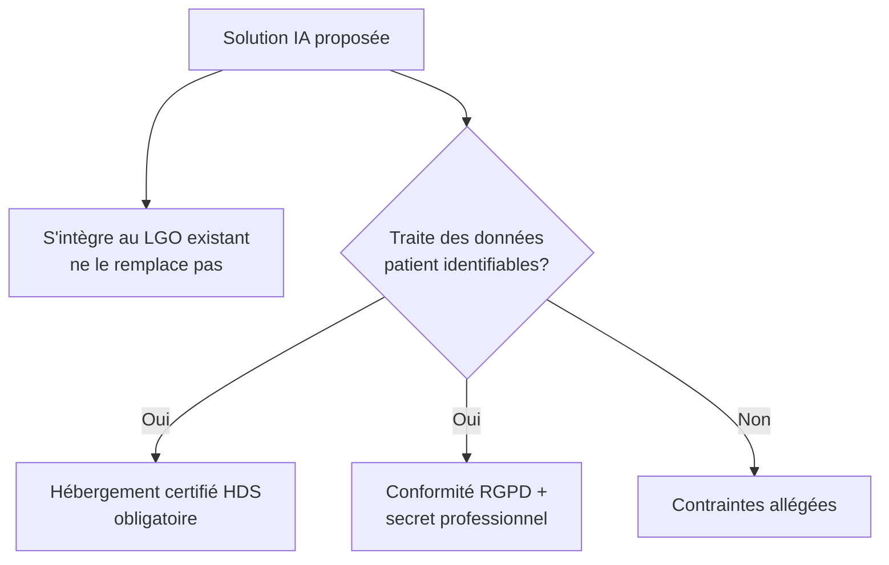

# Module B1 — Cadre réglementaire officine

## Contenu

### 1. La certification LGO (Logiciel de Gestion d'Officine)

Tout logiciel utilisé en pharmacie d'officine pour la gestion des dispensations doit être certifié LGO. Cette certification garantit que le logiciel respecte les référentiels de sécurité et d'interopérabilité fixés par les autorités de santé (source : guide YouFeel, "agences IA pharmacie", juin 2026).

**Implication pour toi en tant que consultant** : toute solution IA que tu proposes ne doit pas se substituer au LGO existant, mais s'y connecter — proposer un remplacement complet du LGO d'une officine est un projet lourd, coûteux et rarement pertinent pour un premier client.

### 2. L'hébergement des données de santé (HDS)

Toute solution manipulant des données de patients (historique de dispensation, données médicales) doit être hébergée sur une infrastructure certifiée HDS (Hébergeur de Données de Santé) — c'est un point non négociable en France (source : guide YouFeel, juin 2026).

**Ce que ça signifie concrètement** :
- Si tu recommandes un outil IA à une pharmacie, vérifier la certification HDS de l'hébergeur est une étape obligatoire de ton audit, pas une option.
- Des outils IA généralistes (non certifiés HDS) ne doivent jamais être utilisés pour traiter des données patient identifiables, même en test.
- Cette contrainte est la même que celle qui s'applique à ton propre projet d'anamnèse naturopathique — la cohérence entre tes deux projets est un atout pour crédibiliser ton expertise.

### 3. Consentement et information du patient

Au-delà de l'hébergement, l'utilisation d'IA impliquant des données patient doit respecter le cadre RGPD général (déjà vu en module A5) : information claire du patient, base légale du traitement, droit d'accès et de rectification. En pharmacie, cela s'articule avec le secret professionnel du pharmacien.

### 4. BPF et ICH (contexte industrie, pour élargir ta culture)

Si tu élargis un jour ton activité vers l'industrie pharmaceutique (au-delà de l'officine), deux référentiels reviennent souvent : les BPF (Bonnes Pratiques de Fabrication) et les ICH Guidelines (recherche clinique internationale) — mentionnés comme cadres de référence dans le secteur (source : guide YouFeel, juin 2026). Ce n'est pas prioritaire pour une activité centrée officine, mais utile à connaître si un client élargit ses besoins.

---

## Schéma — Contraintes à vérifier avant de proposer une solution IA en officine

---

## Checklist de compétences

- [ ] Je sais expliquer ce qu'est un LGO et pourquoi je ne dois pas chercher à le remplacer
- [ ] Je sais vérifier si un hébergeur est certifié HDS avant de recommander un outil
- [ ] Je sais expliquer à un titulaire pourquoi un outil IA généraliste (ChatGPT, etc.) ne doit pas traiter de données patient identifiables
- [ ] Je sais situer le RGPD et le secret professionnel dans le contexte officinal
- [ ] Je sais si BPF/ICH sont pertinents ou non pour un client donné

## Quiz (5 questions)

1. La certification LGO concerne :
   a) Les data centers b) Les logiciels de gestion d'officine ✔ c) Les fabricants de médicaments

2. HDS signifie :
   a) Hébergeur de Données de Santé ✔ b) Haute Disponibilité Système c) Historique des Données Sécurisées

3. Une solution IA généraliste non certifiée HDS peut traiter des données patient identifiables :
   a) Oui, sans restriction b) Non, jamais ✔ c) Oui, avec l'accord oral du patient

4. Remplacer entièrement le LGO d'une officine par une solution IA est :
   a) La meilleure approche pour débuter b) Un projet lourd et rarement pertinent en premier projet ✔ c) Obligatoire

5. Les BPF concernent principalement :
   a) L'officine de ville b) La fabrication industrielle du médicament ✔ c) Le conseil en pharmacie

---

*Source principale : guide YouFeel "agences IA pharmacie" (juin 2026) — source commerciale, à recouper avec une source institutionnelle (ANSM, Ordre national des pharmaciens) avant toute décision engageante pour un client.*

## Estimation de temps d'apprentissage
Contenu plus dense (réglementaire) que les modules A1/A2 : **~45-60 minutes** (lecture + quiz + checklist), estimation basée sur le volume de texte et la complexité du vocabulaire réglementaire.
