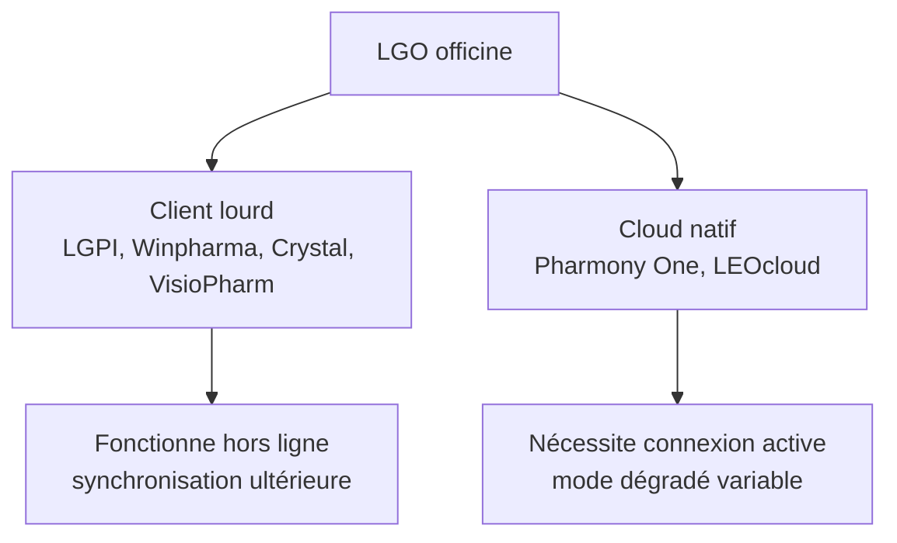

# Module B2 — Écosystème logiciel officinal

## Contenu

### 1. Panorama du marché des LGO en 2026

Le marché des Logiciels de Gestion d'Officine (LGO) est concentré : Smart Rx et LGPI (édité par Pharmagest) représentaient à eux deux plus de 70% du parc officinal selon une analyse de référence du secteur, Winpharma s'étant imposé comme le principal challenger.

Au 23 avril 2026, dix logiciels ont terminé leur "présérie" et sont autorisés à déployer sur toute la France selon la doctrine du numérique en santé : **LGPI (Equasens), LEO (Isipharm), Pharmaland (La Source Informatique), PharmaVitale (CEPI), Winpharma (Everys), VisioPharm, Pharmony One, Smart Rx (Cegedim), Crystal (Infosoft) et Vindilis.**

Contexte marché : au 11 mai 2026, le Conseil national de l'Ordre des pharmaciens (CNOP) recensait 19 898 officines en France métropolitaine et DOM, en baisse de 253 sur un an — un rythme de fermeture moyen de 156 officines/an depuis 2007 selon la Cour des comptes. Ce contexte de consolidation est important pour toi : les officines qui restent cherchent des gains d'efficacité, un terrain favorable pour des solutions IA bien ciblées.

### 2. Le référencement Ségur — le prérequis technique incontournable

Pour fonctionner avec l'ordonnance numérique, un LGO doit être "référencé Ségur". Ce label officiel de l'État certifie le respect des standards d'interopérabilité et de sécurité, garantissant notamment :
- La gestion de l'INS (Identité Nationale de Santé)
- L'alimentation automatique du DMP (Dossier Médical Partagé) / Mon Espace Santé
- L'interopérabilité DP (Dossier Pharmaceutique), MSSanté, carte Vitale

**Implication pour toi** : toute solution IA que tu proposes doit être pensée en cohérence avec ce socle Ségur — le considérer comme un "coût produit continu" plutôt qu'un projet ponctuel, car les éditeurs doivent le maintenir à jour en permanence.

### 3. Architecture technique : client lourd vs cloud

Deux familles d'architecture coexistent :
- **Client lourd** (LGPI, Winpharma, VisioPharm, Crystal) : fonctionne hors ligne avec synchronisation ultérieure — robuste dans les zones à connectivité fragile.
- **Cloud natif** (Pharmony One, LEOcloud) : nécessite une connexion active, avec des modes dégradés plus ou moins complets en cas de coupure.

**Point de vigilance à vérifier chez un client** : dans une zone à connectivité instable, une solution IA cloud pure peut être un frein plutôt qu'un atout — un point d'audit à ne pas négliger.

### 4. Obligations HDS et RGPD spécifiques à l'officine

Toute donnée de santé stockée hors de l'officine (y compris via un cloud tiers comme Azure, AWS, OVH) doit être hébergée chez un prestataire certifié HDS. En complément du RGPD général : registre des traitements, DPO ou point de contact désigné, accès limités, sauvegardes chiffrées, et déclaration de toute fuite de données sous 72h à la CNIL.

### 5. Logique d'intégration plutôt que de remplacement

Le principe reste le même qu'en module B1 : une solution IA doit se connecter à l'écosystème existant (LGO + son référencement Ségur), pas chercher à l'évincer. Vérifier l'existence d'une API ou d'un module d'extension chez l'éditeur du LGO du client est une étape d'audit incontournable avant toute proposition technique.

---

## Schéma — Deux architectures de LGO

---

## Checklist de compétences

- [ ] Je sais citer au moins 4 des 10 LGO référencés Ségur en 2026
- [ ] Je sais expliquer ce que garantit le référencement Ségur (INS, DMP, DP, MSSanté)
- [ ] Je sais distinguer une architecture client lourd d'une architecture cloud, et son impact sur la connectivité
- [ ] Je sais énoncer les obligations HDS + RGPD spécifiques à une officine
- [ ] Je sais expliquer pourquoi l'intégration à l'existant prime sur le remplacement du LGO

## Quiz (5 questions)

1. Les deux éditeurs historiquement dominants du marché LGO (>70% du parc) sont :
   a) LEO et Vindilis b) Smart Rx et Pharmagest (LGPI) ✔ c) Pharmony One et Crystal

2. Le référencement Ségur garantit notamment :
   a) Un tarif réduit b) La gestion de l'INS et l'alimentation du DMP ✔ c) Une garantie de rentabilité

3. Un LGO en architecture "client lourd" :
   a) Nécessite une connexion Internet permanente b) Fonctionne hors ligne avec synchronisation ultérieure ✔ c) N'existe plus en 2026

4. Toute donnée de santé hébergée sur un cloud tiers (Azure, AWS, OVH) doit être :
   a) Chiffrée uniquement b) Hébergée chez un prestataire certifié HDS ✔ c) Dupliquée sur 2 clouds différents

5. En cas de fuite de données, la déclaration à la CNIL doit intervenir sous :
   a) 24h b) 72h ✔ c) 30 jours

---

*Sources : Le Moniteur des Pharmacies (dossier LGO, archives), Clempo.fr (comparatif LGO, mai 2026), Lonasante.fr (comparatif LGO, juin 2026), La Caisse Idéale (logiciel caisse pharmacie, févr. 2026) — recoupées entre elles pour fiabilité, données Ordre national des pharmaciens (CNOP) citées via Clempo.fr.*

## Estimation de temps d'apprentissage
**~45-60 minutes**, comparable à B1 (contenu dense, à recouper avec vérification terrain si tu démarches une officine précise dont tu ne connais pas encore le LGO).
