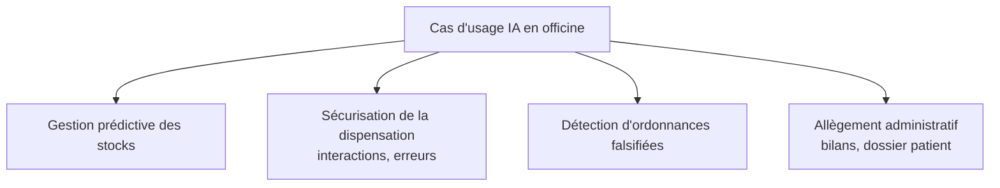

# Module B3 — Cas d'usage IA en officine

## Contenu

### 1. Ce que dit le terrain : des cas réels, pas des promesses

Selon un témoignage professionnel publié en juin 2026, Patrick Raimond, pharmacien titulaire et président du syndicat USPO Bouches-du-Rhône, observe que les usages de l'IA en officine restent encore assez restreints, mais que la dynamique est réelle aussi bien en back-office qu'au comptoir. Il cite comme cas d'usage concrets : la gestion prédictive des stocks, la détection d'ordonnances falsifiées, le contrôle des erreurs de délivrance, la synthèse du dossier patient, l'allègement de la paperasse (notamment pour les bilans de prévention), et la retranscription des entretiens thérapeutiques.

### 2. Gestion prédictive des stocks

Les algorithmes prédictifs analysent l'historique des ventes, la saisonnalité, les tendances locales et les données épidémiologiques pour anticiper les besoins en médicaments. C'est aujourd'hui le cas d'usage le plus mature et le plus documenté en officine.

**Point de méthode pour toi** : sois prudent avec les chiffres de gain annoncés par les éditeurs commerciaux (ex : "-30% de ruptures", "-15 à 25% de stock dormant") — ce sont des moyennes marketing à vérifier sur le terrain avec les données réelles du client, comme vu en module A4.

### 3. Sécurisation de la dispensation

Des outils d'aide à la dispensation vérifient les interactions médicamenteuses et la conformité des produits délivrés. **Règle non négociable** : une solution d'aide à la dispensation qui n'est pas basée sur des bases de données certifiées et n'a pas suivi un processus de validation clinique ne doit pas être utilisée en officine.

**Ce que l'IA ne remplace pas** : le conseil pharmaceutique nécessite une évaluation de la situation spécifique du patient, une communication empathique et une décision médicale qui restent du ressort exclusif du pharmacien. Pour les questions sensibles (symptômes graves, interactions potentiellement dangereuses), la consultation du pharmacien reste irremplaçable et obligatoire.

### 4. Allègement administratif

Retranscription automatique des entretiens thérapeutiques, synthèse de dossier patient, aide à la rédaction des bilans de prévention — ce sont des cas d'usage à faible risque réglementaire (pas de décision clinique autonome) et donc plus faciles à proposer en premier projet avec un client.

### 5. Un signal institutionnel fort : l'AMI ministériel de juin 2026

Une note d'information officielle du ministère de la Santé (DGOS, note n° DGOS/NUM/2026/75 du 8 juin 2026) a lancé un appel à manifestation d'intérêt (AMI) pour explorer le potentiel de l'IA dans la gestion des stocks, la dispensation et l'administration des produits de santé — précisant explicitement que les outils d'IA d'aide à la **prescription médicale** ne sont pas concernés par cet AMI. Cet appel vise à identifier les conditions de réussite, les critères d'éthique et de confiance, et les modalités de déploiement à large échelle.

**Ce que ça signifie pour toi** : c'est un signal institutionnel fort que la gestion logistique par IA (hors décision clinique) est un axe prioritaire soutenu par l'État — un argument utile pour rassurer un client hésitant sur la légitimité de la démarche.

---

## Schéma — Panorama des cas d'usage IA en officine

---

## Checklist de compétences

- [ ] Je sais citer au moins 4 cas d'usage IA concrets et documentés en officine
- [ ] Je sais expliquer pourquoi je dois vérifier les chiffres de gain annoncés par un éditeur avant de les reprendre
- [ ] Je sais expliquer la règle de validation clinique pour un outil d'aide à la dispensation
- [ ] Je sais expliquer ce que l'IA ne peut jamais remplacer dans le conseil pharmaceutique
- [ ] Je sais mentionner l'existence de l'AMI ministériel de juin 2026 comme signal de légitimité institutionnelle

## Quiz (5 questions)

1. D'après le témoignage cité, le cas d'usage IA le plus mature en officine aujourd'hui est :
   a) La prescription automatique b) La gestion prédictive des stocks ✔ c) Le diagnostic médical autonome

2. Un outil d'aide à la dispensation doit impérativement :
   a) Être gratuit b) Être basé sur des bases de données certifiées et validées cliniquement ✔ c) Fonctionner sans connexion Internet

3. Pour les questions sensibles (interactions dangereuses, symptômes graves), la consultation du pharmacien est :
   a) Optionnelle si l'IA a déjà répondu b) Irremplaçable et obligatoire ✔ c) Remplaçable par un chatbot

4. L'AMI ministériel de juin 2026 concerne :
   a) L'aide à la prescription médicale b) La gestion des stocks, la dispensation et l'administration (hors prescription) ✔ c) Le marketing pharmaceutique

5. Face aux chiffres de gain annoncés par un éditeur commercial, la bonne pratique est de :
   a) Les reprendre tels quels dans ta proposition b) Les vérifier sur le terrain avec les données réelles du client ✔ c) Les ignorer systématiquement

---

*Sources : Smart Rx / "L'officine augmentée, pour quoi faire ?" (juin 2026, témoignage de Patrick Raimond, pharmacien titulaire et président USPO Bouches-du-Rhône), Note d'information DGOS/NUM/2026/75 du 8 juin 2026 (Bulletins officiels du ministère de la Santé) — source institutionnelle de premier rang.*

## Estimation de temps d'apprentissage
**~40-50 minutes**
