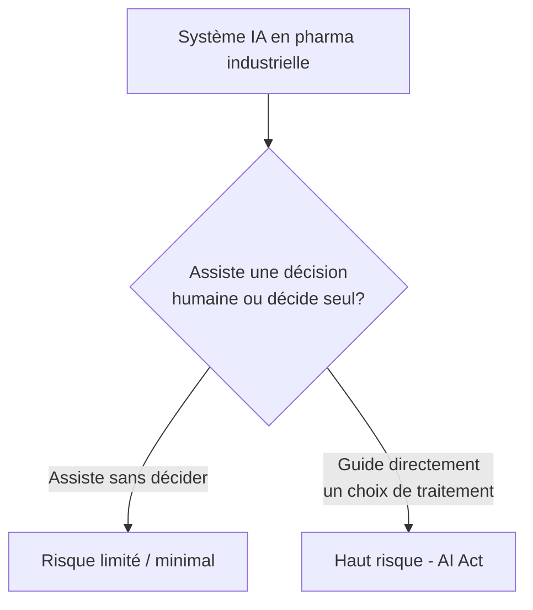

# Module B4 — IA et industrie pharmaceutique

## Contenu

*Ce module élargit ta culture au-delà de l'officine, utile si tu vises aussi des clients côté laboratoires/industrie.*

### 1. Pharmacovigilance augmentée

Les LLM peuvent analyser en continu les bases de notification d'effets indésirables (EudraVigilance en Europe, FAERS/VAERS aux États-Unis) pour détecter des signaux émergents — par exemple une hausse anormale de notifications pour un effet indésirable donné, ou des corrélations avec des populations de patients spécifiques. Des agents IA peuvent aussi surveiller en continu la littérature scientifique et les pré-publications pour repérer des effets indésirables non identifiés lors des essais cliniques, et assister la rédaction des rapports périodiques de sécurité (PSUR).

**Point réglementaire important** : le règlement EMA de 2025 (effectif depuis le 25 juillet 2025) maintient la responsabilité intégrale du titulaire d'autorisation de mise sur le marché (MAH) sur la gestion des signaux de pharmacovigilance, quelle que soit l'automatisation mise en place. L'IA assiste, elle ne transfère jamais la responsabilité légale.

### 2. Essais cliniques : prudence de rigueur

Les laboratoires font preuve de prudence sur les usages d'IA susceptibles d'influencer directement les décisions réglementaires — notamment les modèles simulant la réaction de groupes virtuels de patients à un médicament. Ces approches pourraient à terme aider à prévoir des résultats avant les essais sur l'humain, voire réduire le nombre de patients nécessaires pour certaines études. Un axe de recherche actif : les "jumeaux numériques" de patients, des répliques virtuelles construites à partir de données génomiques, cliniques et d'imagerie, pour prévoir la réponse individuelle à un traitement.

### 3. Affaires réglementaires : un risque concret à connaître

L'usage de LLM pour rédiger ou analyser des dossiers d'AMM (Autorisation de Mise sur le Marché) sans validation GxP (Bonnes Pratiques) expose à un risque réel : la récusation des données lors d'inspections FDA ou EMA. Un algorithme déployé sans validation préalable produit des résultats qui ne sont pas défendables devant les autorités de santé.

Un chiffre à connaître pour sensibiliser un client industrie : 77% des scientifiques pharmaceutiques déclarent déjà utiliser des outils IA publics dans leur travail quotidien (source : VEIA.AI, citant des données 2026) — un usage souvent non encadré ("shadow IA"), dont le coût moyen d'une brèche est estimé à 28,8 millions de dollars/an dans le secteur pharma et santé (source : DTEX, 2026).

### 4. Découverte de médicaments (drug discovery)

L'IA est déjà largement utilisée pour le criblage virtuel de molécules, la prédiction ADMET (Absorption, Distribution, Métabolisme, Excrétion, Toxicité), l'optimisation de molécules candidates, et la sélection de patients pour les essais cliniques.

### 5. Classification AI Act appliquée à la pharma industrielle

Le critère déterminant pour classer un système d'IA selon l'AI Act dans ce secteur est son impact sur les décisions affectant les patients : un outil d'aide à la découverte de molécules qui n'assiste que les chimistes (sans décider) n'est pas nécessairement haut risque, tandis qu'un "companion diagnostic" qui guide directement un choix de traitement l'est clairement. Cette distinction "aide à la décision" vs "décision autonome" est la grille de lecture à retenir.

---

## Schéma — Grille de classification AI Act appliquée à la pharma

---

## Checklist de compétences

- [ ] Je sais citer 3 usages concrets de l'IA en pharmacovigilance
- [ ] Je sais expliquer pourquoi le règlement EMA 2025 maintient la responsabilité du MAH malgré l'automatisation
- [ ] Je sais expliquer le risque de "récusation des données" en affaires réglementaires si un LLM est utilisé sans validation GxP
- [ ] Je sais expliquer ce qu'est un "jumeau numérique" de patient et son usage en essais cliniques
- [ ] Je sais appliquer la grille "aide à la décision vs décision autonome" pour classer un système IA pharma selon l'AI Act

## Quiz (5 questions)

1. EudraVigilance est :
   a) Un logiciel de gestion d'officine b) Une base européenne de notification des effets indésirables ✔ c) Un référentiel de coûts pharma

2. Le règlement EMA 2025 précise que la responsabilité de la pharmacovigilance incombe :
   a) À l'IA utilisée b) Toujours au titulaire de l'AMM (MAH), quelle que soit l'automatisation ✔ c) À l'éditeur du logiciel IA

3. Utiliser un LLM pour rédiger un dossier d'AMM sans validation GxP expose principalement à :
   a) Un coût plus élevé b) Un risque de récusation des données lors d'inspections FDA/EMA ✔ c) Une lenteur administrative

4. Un "companion diagnostic" qui guide directement un choix de traitement est classé, selon l'AI Act :
   a) Risque minimal b) Haut risque ✔ c) Hors du champ de l'AI Act

5. ADMET, dans le contexte de la découverte de médicaments par IA, fait référence à :
   a) Une norme de sécurité informatique b) Absorption, Distribution, Métabolisme, Excrétion, Toxicité ✔ c) Un protocole d'essai clinique

---

*Sources : VEIA.AI (gouvernance IA industrie pharmaceutique, 2026, citant règlement EMA 2025 et données DTEX 2026), Swissinfo (essais cliniques et IA, juin 2026), formation-ia-act.fr (AI Act appliqué à la pharma, déc. 2025), YouFeel.fr (guide agence IA pharmacie, juin 2026) — sources à recouper avec les textes réglementaires officiels (EMA, ANSM) avant toute mission facturée sur ce périmètre.*

## Estimation de temps d'apprentissage
**~45-55 minutes** (module le plus technique du parcours, hors périmètre officine)
