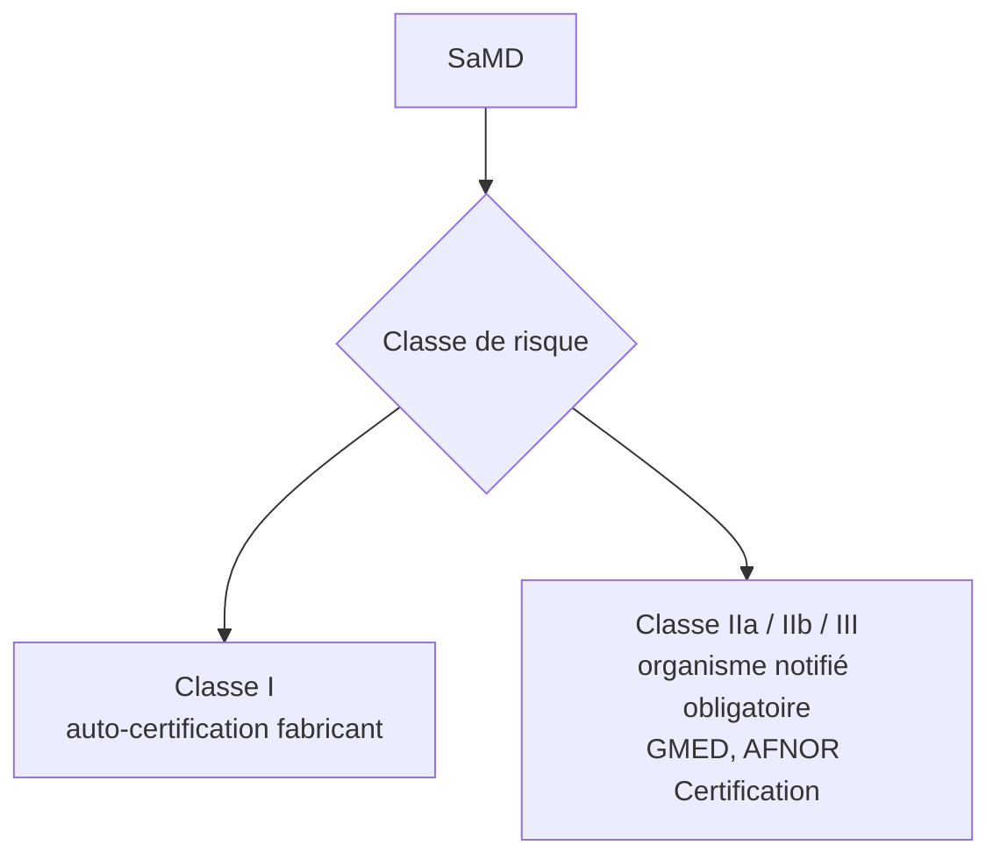

# Module B5 — Dispositifs médicaux IA (module optionnel avancé)

## Contenu

*Module avancé, pertinent si tu conseilles un éditeur de logiciel médical ou une officine évaluant un outil certifié dispositif médical.*

### 1. SaMD : de quoi parle-t-on ?

Un SaMD (Software as a Medical Device) est un logiciel autonome ayant une finalité médicale en lui-même (à distinguer du SiMD, un logiciel embarqué qui pilote un dispositif physique). Un dispositif intégrant de l'IA est parfois désigné MDAI (à ne pas confondre avec AIMD, dispositif médical implantable actif).

### 2. Classification et marquage CE

Le marquage CE d'un dispositif médical logiciel dépend de sa classe de risque :
- **Classe I** (risque faible : stockage, archivage, aide à la décision sans impact direct sur le traitement) : auto-certification par le fabricant, mais marquage CE, documentation technique et respect de la norme IEC 62304 restent obligatoires.
- **Classes IIa, IIb, III** (risque croissant) : l'intervention d'un organisme notifié devient obligatoire. En France, le GMED et l'AFNOR Certification sont les organismes notifiés habilités.

**Délai à anticiper** : compter 3 à 6 mois pour la contractualisation avec l'organisme notifié, puis 6 à 12 mois pour l'audit et l'obtention du certificat — soit 12 à 18 mois au total une fois le dossier prêt. Un délai incompressible à intégrer dans toute feuille de route.

### 3. Articulation MDR / IVDR / AI Act

Le MDR (règlement UE 2017/745, applicable depuis mai 2021) et l'IVDR (dispositifs de diagnostic in vitro, depuis mai 2022) encadrent la sécurité clinique, la performance et la gestion des risques. Ni le MDR ni l'IVDR ne prévoient d'exigences spécifiques à l'IA en tant que telle — c'est l'AI Act qui ajoute cette couche, avec un focus sur les droits fondamentaux, les biais algorithmiques, la traçabilité des décisions et la supervision humaine.

**Point de vigilance sur le calendrier (sujet évolutif, à revérifier au moment de ta mission)** : les sources disponibles début août 2026 ne sont pas toutes alignées sur la date exacte d'application des obligations "haut risque" de l'AI Act aux dispositifs médicaux, notamment après le report du calendrier par le "Digital Omnibus" (voir module A5). Certaines sources indiquent une distinction entre dispositifs déjà soumis à un organisme notifié (MDR/IVDR) et les autres. **Ne communique pas de date ferme à un client sans revérifier ce point auprès d'une source officielle (ANSM, Commission européenne) au moment de la mission** — c'est un exemple concret où la prudence prime sur la rapidité.

### 4. Suivi post-commercialisation

Au-delà de la certification initiale, un SaMD intégrant de l'IA nécessite un suivi continu : matériovigilance (remontée d'incidents), surveillance du marché par l'ANSM en France (qui peut imposer des mesures correctives, du rappel produit à l'interdiction de mise sur le marché), et alimentation de la base européenne EUDAMED (dont 4 modules deviennent obligatoires à partir du 28 mai 2026).

### 5. Ce que ça signifie pour ton positionnement de consultant

Ce module est probablement le moins prioritaire pour un début d'activité centré sur l'officine — la certification dispositif médical concerne davantage les éditeurs de logiciels ou les industriels que le pharmacien d'officine lui-même. Mais le connaître te permet de savoir orienter un client vers les bons interlocuteurs (organismes notifiés, consultants spécialisés MDR) si son besoin dépasse ton périmètre — plutôt que de t'aventurer sur un terrain réglementaire très pointu sans expertise certifiante.

---

## Schéma — Classification SaMD et marquage CE

---

## Checklist de compétences

- [ ] Je sais différencier SaMD et SiMD
- [ ] Je sais expliquer les 4 classes de risque d'un dispositif médical logiciel et quand un organisme notifié intervient
- [ ] Je sais citer les organismes notifiés français (GMED, AFNOR Certification)
- [ ] Je sais expliquer que MDR/IVDR et AI Act sont complémentaires, pas substituables
- [ ] Je sais reconnaître que le calendrier AI Act pour les DM est un sujet à revérifier au moment de chaque mission, pas un fait figé

## Quiz (5 questions)

1. Un SaMD est :
   a) Un logiciel embarqué pilotant un dispositif physique b) Un logiciel autonome à finalité médicale en lui-même ✔ c) Un capteur physique

2. Pour un dispositif de classe I, la certification passe par :
   a) Un organisme notifié obligatoire b) L'auto-certification du fabricant (avec marquage CE et IEC 62304 obligatoires) ✔ c) Aucune formalité

3. En France, les organismes notifiés pour le marquage CE des dispositifs médicaux incluent :
   a) L'URSSAF et la CNIL b) Le GMED et l'AFNOR Certification ✔ c) L'INPI et l'OPT-NC

4. Le MDR/IVDR et l'AI Act, pour un dispositif médical IA, sont :
   a) Deux textes concurrents dont un seul s'applique b) Deux textes complémentaires qui s'appliquent simultanément ✔ c) Un texte unique fusionné

5. Face à une question de calendrier réglementaire précis sur les DM IA, la bonne pratique est de :
   a) Donner la date la plus récemment lue sans vérifier b) Signaler que le sujet évolue et vérifier auprès d'une source officielle avant tout engagement client ✔ c) Ignorer la question

---

*Sources : Socialcare/Orisha (marquage CE dispositifs médicaux, avril 2026), MD101.io (IA dans les dispositifs médicaux, avril 2026), Bob le développeur (certification SaMD/MDR, mars 2026), MedtechFrance (conformité IA médicale, nov. 2025), MDxCRO.com (SaMD EU MDR compliance, sources datées mars 2026 et récentes) — sources partiellement contradictoires sur le calendrier précis AI Act/DM, signalé explicitement ci-dessus plutôt que tranché arbitrairement.*

## Estimation de temps d'apprentissage
**~40-50 minutes** (module optionnel, à traiter en dernier dans ton parcours)
